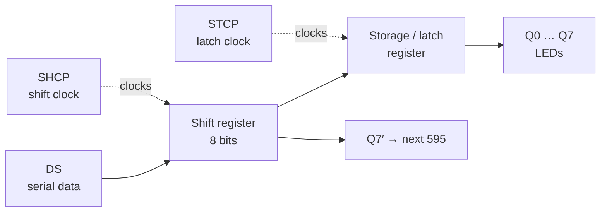
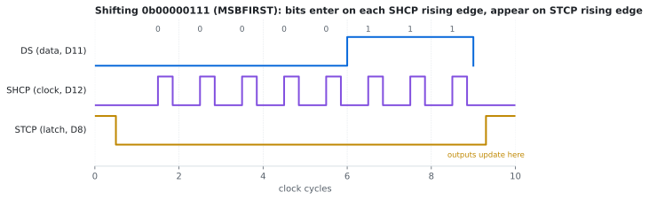
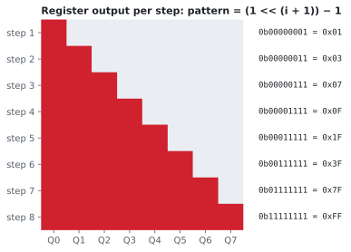

# 🔢 74HC595 Sequential LED Control

> Driving 8 LEDs from 3 Arduino pins with a serial-in, parallel-out shift register. It's a small project, but it covers clocked logic, serial protocols, and why a latch exists.


---

## Contents
1. [Project Overview](#1-project-overview) · 2. [Objective](#2-objective) · 3. [Components](#3-components) · 4. [Working Principle](#4-working-principle) · 5. [Circuit Design](#5-circuit-design) · 6. [Implementation](#6-implementation) · 7. [Source Code](#7-source-code) · 8. [Results](#8-results) · 9. [Challenges](#9-challenges) · 10. [Future Improvements](#10-future-improvements)

---

## 1. Project Overview

An Arduino Uno has 20 I/O pins. Driving 8 LEDs directly uses 8 of them, and a 64-LED matrix couldn't be done that way at all. The 74HC595 solves this by taking data **one bit at a time** on a single wire and presenting it on **8 parallel outputs**.

The demo lights the LEDs one after another, keeps each one on, and resets once all eight are lit.

## 2. Objective

- Understand serial-to-parallel conversion and clocked digital logic.
- Learn the roles of the **data**, **shift clock** and **latch** signals.
- Cut the number of microcontroller pins needed for output: 8 outputs from 3 pins, and 16, 24… by chaining chips.

## 3. Components

| Component | Role | Why |
|---|---|---|
| Arduino Uno | Sends the serial data | Reconstructed implementation |
| 74HC595 | 8-bit shift register with output latch | Has a separate **storage register**, so outputs don't flicker while bits are moving in (a plain shift register like the 74HC164 does) |
| 8 × LED | Outputs | |
| 8 × 470 Ω | LED current limiting | (5 − 2) V / 470 Ω ≈ 6 mA per LED, ≈ 51 mA with all 8 on. That keeps the whole chip under its 70 mA V<sub>CC</sub>/GND limit (330 Ω would put it at ≈ 73 mA, over the limit). |
| 100 nF capacitor | Decoupling across VCC–GND | Absorbs the switching current spikes when all 8 outputs change at once |

## 4. Working Principle

The 74HC595 contains **two** 8-bit registers:



1. The Arduino pulls **STCP (latch) LOW**.
2. For each of the 8 bits it sets **DS** and pulses **SHCP**. On each rising edge, every bit moves one position and the new bit enters.
3. The Arduino pulls **STCP HIGH**. On that rising edge, all 8 bits are copied to the outputs **at the same moment**.

<p align="center"></p>

**Why the latch matters:** without it, the LEDs would visibly show every intermediate position while the bits are shifted through. The latch lets the shifting happen "behind the scenes".

### The pattern

Each step sets one more bit with `(1 << (i + 1)) − 1`:

<p align="center"></p>

## 5. Circuit Design

| 74HC595 pin | Signal | Connects to | Reason |
|---|---|---|---|
| 14 | DS | Arduino D11 | serial data |
| 11 | SHCP | Arduino D12 | shift clock |
| 12 | STCP | Arduino D8 | latch |
| 13 | OE (active LOW) | GND | outputs always enabled |
| 10 | MR (active LOW) | 5 V | never cleared |
| 16 | VCC | 5 V + 100 nF to GND | |
| 8 | GND | GND | |
| 15, 1–7 | Q0–Q7 | 470 Ω → LED → GND | |

> **Reconstruction note:** Controller used in the reconstructed implementation: Arduino Uno. Pin assignments are proposed, not confirmed original connections.

## 6. Implementation

1. Place the 74HC595 across the breadboard's centre gap and add the 100 nF capacitor right next to pins 16 and 8.
2. Wire OE to GND and MR to 5 V **first**. If either is left floating, the chip behaves randomly.
3. Wire Q0–Q7 to the LEDs through 470 Ω resistors.
4. Connect DS, SHCP and STCP to the Arduino.
5. Test with a single fixed pattern (e.g. `0b10101010`) before running the animation.

## 7. Source Code

📄 [`Code/shift_register_sequence/shift_register_sequence.ino`](Code/shift_register_sequence/shift_register_sequence.ino)

```cpp
void updateRegister(byte value) {
  digitalWrite(LATCH_PIN, LOW);                       // hold outputs
  shiftOut(DATA_PIN, CLOCK_PIN, MSBFIRST, value);     // 8 bits in
  digitalWrite(LATCH_PIN, HIGH);                      // rising edge → outputs update
}
```

**Why `MSBFIRST`:** the first bit shifted in ends up furthest along, in Q7. Sending the MSB first means bit 0 lands on Q0, so the binary value and the physical LED order match.

## 8. Results

- 8 LEDs controlled from 3 GPIO pins.
- The LEDs light progressively from Q0 to Q7, stay on together, then clear and repeat.
- Outputs change cleanly, with no visible flicker during shifting, thanks to the latch.

## 9. Challenges

- **Floating control pins.** OE and MR are easy to forget. Left unconnected, they pick up noise and the outputs blink or clear at random.
- **Bit order.** If the LED order comes out reversed, the cause is `MSBFIRST` vs `LSBFIRST`, not the wiring.
- **Current budget.** With all 8 LEDs on, the total current goes through one chip. The resistor values have to keep that below the package limit, not just each LED's limit.

## 10. Future Improvements

- [ ] Chain two 74HC595s through Q7′ for 16 outputs.
- [ ] Reverse, bounce and "Knight Rider" patterns.
- [ ] Use a potentiometer to control sequence speed.
- [ ] Replace `shiftOut()` with **hardware SPI** (much faster) and compare timing on a logic analyzer.
- [ ] Capture DS / SHCP / STCP on a logic analyzer to check the timing diagram.

## References

See [`References/`](References/).
